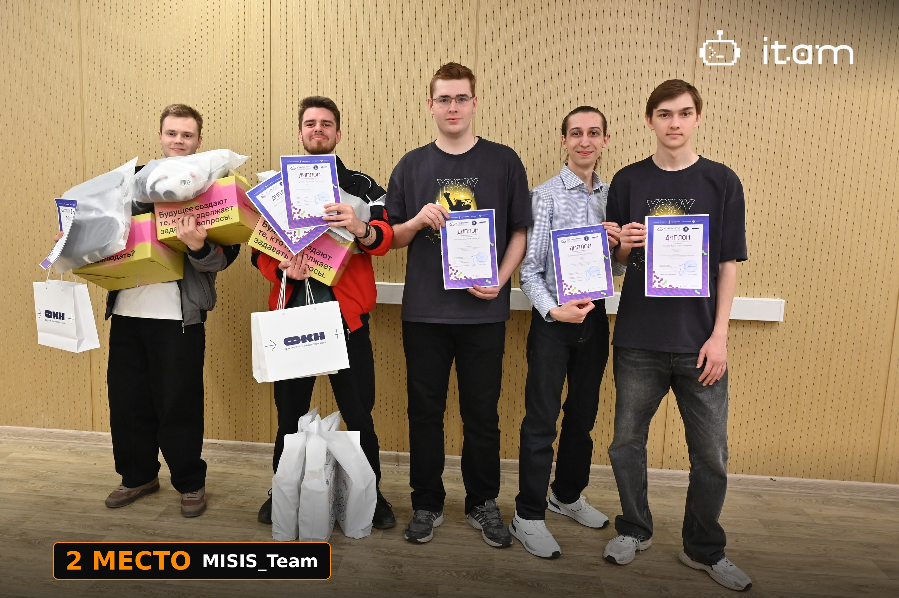
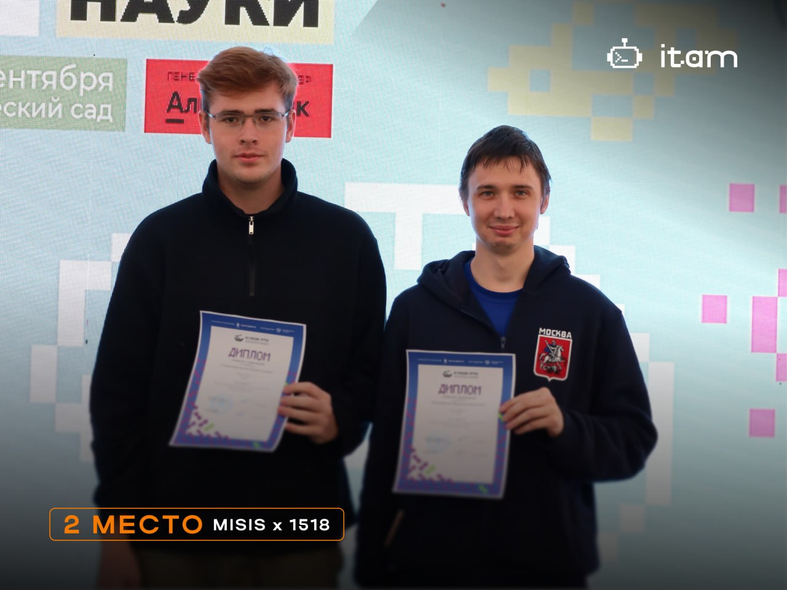
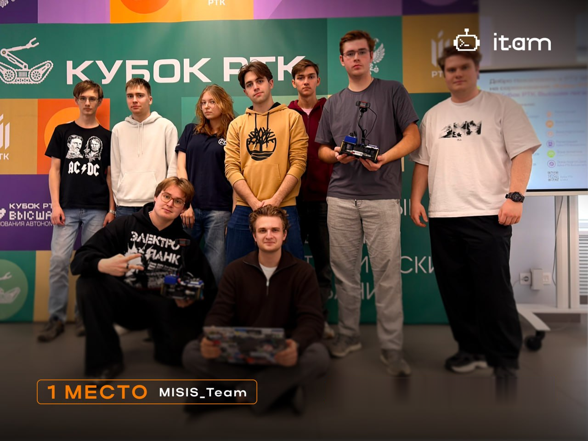
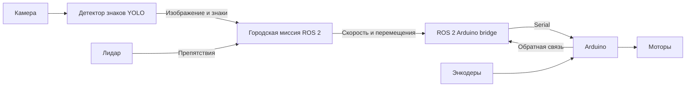
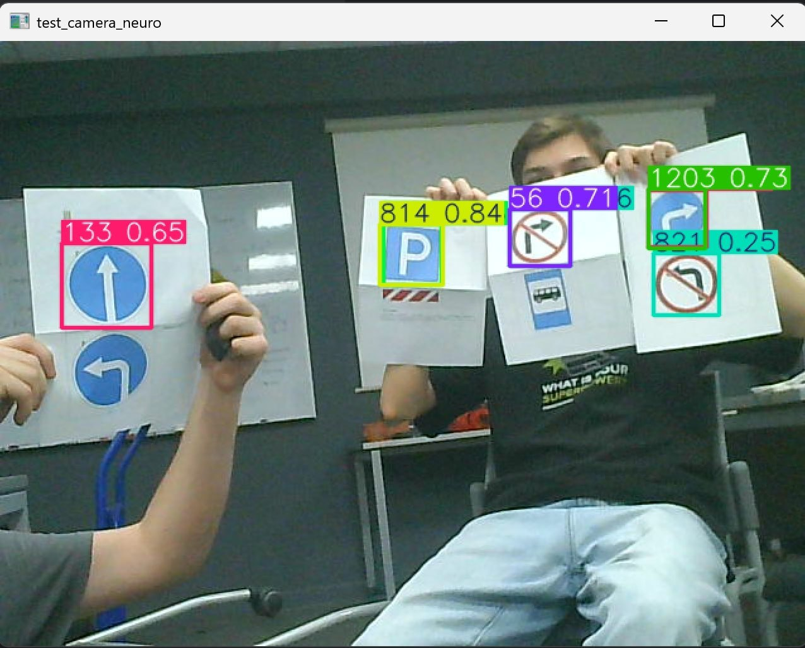

# Команда МИСИС — Движение по городу · Кубок РТК Высшая лига

Репозиторий робототехнической команды МИСИС: общая платформа **Frob**, программные решения и история участия в хакатоне **«Движение по городу»**. В сезоне 2026 года команда выступила на трёх этапах: в НИУ ВШЭ и МИРЭА — под названием **MISIS_Team**, в Минске — **MISIS × 1518**.

**Три этапа — три призовых места: два вторых и одно первое.** Состав команды и особенности решения каждого этапа приведены ниже.

| Этап | Даты | Команда | Результат |
| --- | --- | --- | --- |
| Москва, НИУ ВШЭ | 1–3 апреля 2026 | MISIS_Team | 2 место |
| Минск | 5–6 сентября 2026 | MISIS × 1518 | 2 место |
| Москва, МИРЭА | 12–13 сентября 2026 | MISIS_Team | 1 место |

Даты и названия площадок — по [официальному расписанию организаторов](https://cup.rtc.ru/lp/lp/raspisanie/). Составы, результаты, сведения о решениях и призах приведены по информации участников.

[Задание](#задание) · [Платформа](#платформа-frob) · [Этапы и команды](#этапы-и-команды) · [Код и запуск](#код-и-запуск) · [Подготовка](#подготовка) · [Сборка](#сборка) · [Запуск](#запуск) · [Документация](#документация)

## Задание

«Кубок РТК Высшая лига» — соревнования автономных роботов в формате тематических хакатонов с задачами навигации и технического зрения. [Описание формата от организаторов](https://cup.rtc.ru/lp/cup-rtc-vishaya-liga/).

В хакатоне **«Движение по городу»** робот самостоятельно доставляет условных пассажиров из зон посадки в зону высадки. На всём маршруте он должен учитывать дорожные знаки, разметку и ограничения проезда. У знака **«Остановка»** требуется остановиться на **2 секунды**, а завершить маршрут — остановкой перед знаком **«Парковка»**.

Полигон моделирует городской квартал размером **4 × 4 м** из **25 ячеек** со стороной 800 мм. При подготовке разрешается построить собственную карту для навигации. Подробности — в [описании хакатона от ЦНИИ РТК, версия от 24.04.2025](https://cup.rtc.ru/cup_rtc/lp/doc/vl/Hakaton_Gorod_V2025_1.pdf).

## Платформа Frob


**Frob** — мобильная роботизированная платформа с открытым исходным кодом для обучения робототехнике и работы с ROS 2. Описание оборудования общее для проекта; особенности программных решений приведены по этапам ниже.

| Компонент | Назначение |
| --- | --- |
| Raspberry Pi | Выполнение ROS 2-узлов, обработка камеры, навигация и логика миссии |
| Arduino | Управление моторами, обработка энкодеров и выполнение команд перемещения |
| Камера | Распознавание дорожных знаков и анализ дорожной разметки |
| Лидар | Сканирование окружения, обнаружение препятствий и данные для навигации |
| Энкодеры и IMU | Оценка движения и ориентации робота |

Программная часть использует **Python, C++, ROS 2, OpenCV и YOLO**. В базовой платформе предусмотрены SLAM, Nav2, энкодерная одометрия и объединение показаний датчиков. Для камеры в опубликованном детекторе заданы разрешение **640 × 480** и размер входа нейросети **320**; эти параметры можно менять в launch-файле.

[Исходный проект Frob](https://github.com/dark516/Frob_robot) · [Wiki платформы](https://github.com/dark516/Frob_robot/wiki) · [Руководство](docs/MANUAL.md) · [English manual](docs/MANUAL.eng.md)

## Этапы и команды

### 1. Москва, НИУ ВШЭ — MISIS_Team

**1–3 апреля 2026 года · Кубок РТК Высшая лига: НИУ ВШЭ · 2 место**

Первый этап команды прошёл в Москве в рамках **IV Фестиваля робототехники ФКН НИУ ВШЭ**. Задание — автономная перевозка условных пассажиров по городскому полигону с соблюдением дорожных знаков и разметки. [Описание этапа от организаторов](https://cup.rtc.ru/lp/raspisanie2026/vysshayaliga/msk-april-vl/).

Состав команды и роли на этапе:

| Участник | Роль | Вклад в решение |
| --- | --- | --- |
| [Голышев Юрий Александрович](https://github.com/wodocanal) | Разработчик ROS 2 | Основной программный пайплайн и логика движения робота по полигону |
| [Ромазанов Артём Валентинович](https://github.com/Artem-Romazanov) | Разработчик компьютерного зрения | Распознавание дорожных знаков и обучение модели YOLO |
| [Тамбовцев Савва Викторович](https://github.com/CardlnaI) | Инженер платформы | Адаптация мобильной платформы Frob к заданию хакатона |

На первом этапе решение разделили на две основные задачи: распознавание дорожных знаков и движение по ячейкам полигона. Команда использовала платформу Frob, ROS 2, OpenCV и обученную модель YOLO для распознавания знаков. На этапе команда заняла **2 место**.



[Описание решения первого этапа](docs/history/README-before-september.md)

### 2. Минск — MISIS × 1518

**5–6 сентября 2026 года · Кубок РТК Высшая лига: Минск · 2 место**

Состав команды и роли на этапе:

| Участник | Роль | Вклад в решение |
| --- | --- | --- |
| [Ромазанов Артём](https://github.com/Artem-Romazanov), БПМ-25-6-2 | Разработчик ROS 2 | Совместная разработка и настройка ROS 2-части решения |
| [Михайленко Ярослав](https://github.com/yaroslav-yarik), МПМ-26-1 | Разработчик ROS 2 | Совместная разработка и настройка ROS 2-части решения |

В Минске команда использовала ROS 2, лидар и нейросетевое распознавание дорожных знаков YOLO. По информации участников, робот самостоятельно нашёл зону посадки, выполнил двухсекундную остановку и завершил маршрут у «Парковки» без нарушений.

Опубликованный код объединяет обработку разметки в OpenCV, распознавание знаков, контроль препятствий по лидару и команды движения через Arduino. Параметры миссии вынесены в YAML; для наблюдения за работой предусмотрены видеопотоки с результатами детекции и отладкой движения.

**Призы:** наборы инструментов Mijia Toolbox и оплаченные путёвки на финал в рамках Конгресса молодых учёных.



[Решение и инструкция запуска](#код-и-запуск)

### 3. Москва, МИРЭА — MISIS_Team

**12–13 сентября 2026 года · Кубок РТК Высшая лига: МИРЭА · 1 место**

Состав команды и роли на этапе:

| Участник | Роль | Вклад в решение |
| --- | --- | --- |
| [Голышев Юрий](https://github.com/wodocanal), БИВТ-25-6-2 | Верхний уровень и ROS 2 | Разработка верхнеуровневой логики робота и интеграция ROS 2-модулей совместно с Артёмом |
| [Ромазанов Артём](https://github.com/Artem-Romazanov), БПМ-25-6-2 | Верхний уровень и ROS 2 | Разработка верхнеуровневой логики робота и интеграция ROS 2-модулей совместно с Юрием |
| [Михайленко Ярослав](https://github.com/yaroslav-yarik), МПМ-26-1 | Нижний уровень и Arduino | Программирование Arduino и низкоуровневое управление моторами |

В Москве команда использовала модульную архитектуру ROS 2, компьютерное зрение на OpenCV и разделение задач между Raspberry Pi и Arduino: одноплатный компьютер выполнял навигацию и распознавание меток, а микроконтроллер управлял моторами. Практические испытания помогли настроить алгоритмы под условия полигона и повысить надёжность прохождения маршрута.

**Призы:** фирменный мерч МИРЭА и лабораторные блоки питания.



## Код и запуск

В качестве основного решения опубликована версия с минского этапа. Она включает прошивку Arduino, ROS 2-мост для обмена с контроллером, карту полигона, детектор знаков и управление городской миссией.

Параметры оборудования, карта и калибровки соответствуют минскому решению. При переносе на другой робот нужно проверить устройства, направление вращения моторов и параметры движения.

### Архитектура опубликованного решения



Детектор передаёт узлу миссии исходное изображение и найденные знаки. Узел миссии анализирует разметку, учитывает препятствия и отправляет команды контроллеру через ROS 2-мост.

### Состав решения

- `frob_sign_detection` открывает камеру, запускает YOLO и публикует изображения и обнаруженные знаки.
- `frob_city_mission` обрабатывает белую разметку с помощью OpenCV, выбирает действия по знакам, останавливается перед препятствиями по данным `/scan` и управляет состояниями миссии.
- `ros2_arduino_bridge` передаёт команды скорости и дискретных перемещений на Arduino.
- `frob_bringup` запускает мост, лидар, IMU, описание робота и одометрию. В поставленной конфигурации выбран драйвер `sllidar_c1_launch.py`.
- `frob_navigation` содержит карту и отдельные средства SLAM/Nav2. Они не запускаются автоматически узлом городской миссии: опубликованная миссия следует разметке камеры.

Дополнительно сохранён [исходный `move.py`](examples/minsk/README.md) из корня минской папки: отдельный сценарий фиксированных перемещений через ROS-сервисы. Он не входит в автоматический запуск миссии.

### Структура исходников

| Путь | Содержимое |
| --- | --- |
| [`examples/minsk`](examples/minsk) | Исходный сценарий фиксированного маршрута `move.py` |
| [`ros2/src/arduino2/arduino_code`](ros2/src/arduino2/arduino_code) | Прошивка и настройки контроллера моторов |
| [`ros2/src/ros2_ws/src/frob_sign_detection`](ros2/src/ros2_ws/src/frob_sign_detection) | Детектор YOLO, веса и видеопоток |
| [`ros2/src/ros2_ws/src/frob_city_mission`](ros2/src/ros2_ws/src/frob_city_mission) | Движение по разметке, обработка знаков и состояния миссии |
| [`ros2/src/ros2_ws/src/frob_navigation`](ros2/src/ros2_ws/src/frob_navigation) | Карта, SLAM и Nav2 |
| [`ros2/src/ros2_ws/src/ros2_arduino_bridge`](ros2/src/ros2_ws/src/ros2_arduino_bridge) | Обмен с Arduino по Serial |

### Распознавание знаков

Пример кадра с камеры: обнаруженные дорожные знаки выделены рамками с оценками уверенности.



Архитектура модели, записанная в метаданных переданного файла `best.pt`, — **YOLO26s**. Веса опубликованы из предоставленного решения без переобучения. Подробности и контрольная сумма — в [описании модели](ros2/src/ros2_ws/src/frob_sign_detection/models/README.md).

### Подготовка

Нужны ROS 2 Jazzy, Python 3.12, инструменты `colcon` и `rosdep`, подключённые камера, лидар и Arduino с прошивкой из `ros2/src/arduino2/arduino_code`. Базовая установка платформы описана в [руководстве Frob](docs/MANUAL.md).

Клонируйте репозиторий в выбранный каталог и перейдите в него:

```bash
git clone https://github.com/romazanovart/RTK_Gorod.git
cd RTK_Gorod
source /opt/ros/jazzy/setup.bash
```

Веса `best.pt` уже включены в репозиторий. Проверить их контрольную сумму можно командой:

```bash
sha256sum ros2/src/ros2_ws/src/frob_sign_detection/models/best.pt
```

Ожидаемая сумма: `e609e19448bf5c6f3678012fa7611b8030bd0b8fcc0343ef134a72d9aca47ef9`.

Создайте окружение для детектора с доступом к системным ROS-пакетам:

```bash
python3 -m venv --system-site-packages ros2/venv-yolo
ros2/venv-yolo/bin/python -m pip install -r requirements-yolo.txt
```

В переданном окружении были установлены Ultralytics 8.4.140, PyTorch 2.14.0+cpu, OpenCV 5.0.0.93 и NumPy 2.5.2. `requirements-yolo.txt` фиксирует версию Ultralytics; остальные зависимости устанавливаются пакетным менеджером для целевой системы. Это запись исходного окружения, а не результат проверки на других платформах.

### Сборка

Из корня репозитория:

```bash
cd ros2/src/ros2_ws
rosdep install --from-paths src --ignore-src -r -y
colcon build --symlink-install
source install/setup.bash
```

Собирать пакеты следует системным Python из окружения ROS 2. Виртуальное окружение YOLO задаётся отдельно при запуске детектора.

### Запуск

Все команды ниже выполняются из корня репозитория в отдельных терминалах. В каждом терминале загрузите окружение:

```bash
source /opt/ros/jazzy/setup.bash
source ros2/src/ros2_ws/install/setup.bash
```

**Оборудование и одометрия:**

```bash
ros2 launch frob_bringup bringup.launch.py
```

**Камера и детектор знаков:**

```bash
ros2 launch frob_sign_detection sign_detection.launch.py \
  python_executable:="$PWD/ros2/venv-yolo/bin/python"
```

Путь к интерпретатору настраивается через `python_executable`; привязки к `/home/pi/Frob_robot` нет. Камера по умолчанию — `/dev/video0`. Разрешение, порог уверенности, размер входа модели и ограничение частоты заданы в `frob_sign_detection/launch/sign_detection.launch.py`. Исходное ограничение частоты обработки — **4 кадра/с**, что не является измерением фактической производительности.

**Узел миссии:**

```bash
ros2 launch frob_city_mission city_mission.launch.py
```

Узел запускается в состоянии `IDLE`. Проверка движения на одну ячейку и старт полной миссии вызывают движение робота:

```bash
# Проверка одной ячейки
ros2 service call /city_mission/test_cell std_srvs/srv/Trigger '{}'

# Запуск полной миссии
ros2 service call /city_mission/start std_srvs/srv/Trigger '{}'

# Запрос остановки
ros2 service call /city_mission/stop std_srvs/srv/Trigger '{}'
```

Управление остановкой передаётся через ROS 2; это не аппаратный аварийный выключатель. На время проверки обеспечьте доступ к выключателю питания робота.

### Наблюдение и настройки

В браузере устройства в той же сети откройте `http://<IP-робота>:8080/` для просмотра распознавания знаков или `http://<IP-робота>:8081/` для отладки линии и состояния миссии.

| Интерфейс ROS 2 | Содержимое |
| --- | --- |
| `/camera/image_raw` | Изображение с камеры, `sensor_msgs/Image` |
| `/sign_detector/detections` | JSON с обнаруженными знаками, `std_msgs/String` |
| `/sign_detector/image/compressed` | Изображение с детекциями, `sensor_msgs/CompressedImage` |
| `/scan` | Данные лидара, `sensor_msgs/LaserScan` |
| `/city_mission/state` | Состояние миссии, `std_msgs/String` |
| `/city_mission/line_debug/compressed` | Отладочное изображение разметки |
| `/cmd_vel` | Команды скорости, `geometry_msgs/Twist` |
| `/forward_robot`, `/rotate_robot` | Сервисы дискретного перемещения и поворота |

Настройки поведения находятся в [`mission.yaml`](ros2/src/ros2_ws/src/frob_city_mission/config/mission.yaml). В исходной конфигурации заданы скорость 0,07 м/с, остановка у знака на 2,2 с, одна ожидаемая зона посадки и дистанция остановки перед препятствием 0,25 м. Это настройки конкретного решения; их следует согласовать с роботом и полигоном.

Карта минского полигона сохранена в `frob_navigation/maps/map.pgm` и `map.yaml`. Она не является универсальной картой для других площадок.

### Проверка переноса

При подготовке обновления проверены синтаксис Python, XML-манифесты пакетов, ссылки в документации и целостность весов по контрольной сумме. В ROS 2 Jazzy собраны пакеты `frob_interfaces`, `frob_sign_detection`, `frob_city_mission` и `ros2_arduino_bridge` с системным Python `/usr/bin/python3`. Launch-файлы проверены без запуска оборудования. Прошивка Arduino, загрузка модели для инференса и движение на физическом роботе в эту проверку не входят.

## Документация

| Материал | Что внутри |
| --- | --- |
| [Сборка и запуск решения](#подготовка) | Зависимости, команды запуска, параметры миссии и интерфейсы ROS 2 |
| [Руководство по платформе](docs/MANUAL.md) | Сборка Frob, установка ROS 2 и работа с оборудованием |
| [Platform guide in English](docs/MANUAL.eng.md) | Краткое руководство по базовой платформе на английском |
| [Веса детектора](ros2/src/ros2_ws/src/frob_sign_detection/models/README.md) | Происхождение модели, версия и контрольная сумма |
| [Описание первого этапа](docs/history/README-before-september.md) | Решение команды на этапе НИУ ВШЭ |
| [Учебные задания Frob](docs/TASKS.ru.md) | Дополнительные упражнения по робототехнике |
